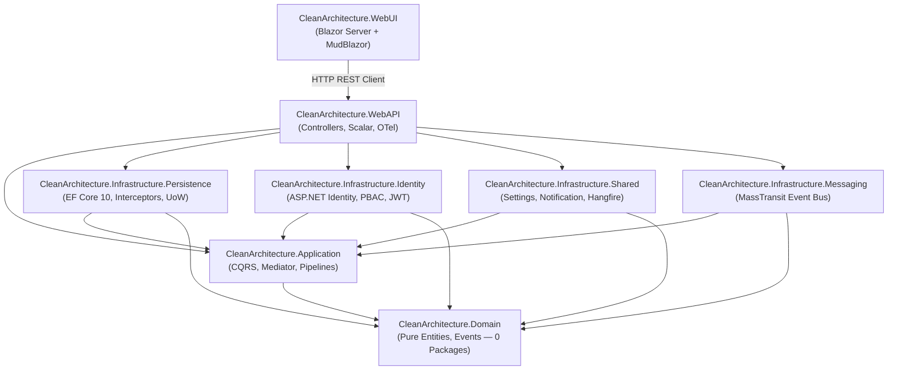

# ⚡ Clean Architecture Enterprise Template (.NET 10)

> **The premier, production-ready ASP.NET Core solution template engineered with Clean Architecture principles, compile-time Source-Generated CQRS (100% Free MIT), Granular PBAC Security, Real-Time Notifications, Automated Audit Diffing, and an Enterprise MudBlazor UI.**

[](https://dotnet.microsoft.com/download)
[](LICENSE)
[-f97316.svg?style=for-the-badge)](https://github.com/martinothamar/Mediator)
[](https://mudblazor.com/)
[](https://learn.microsoft.com/ef/core/)
[](https://www.nuget.org/packages/Minimdev.CleanArchitecture.Template)
[](tests)

---

## ⚡ Quickstart (Get Running in 60 Seconds)

Create a fully scaffolded, production-grade enterprise solution with a single CLI command:

```bash
# 1. Install template from NuGet
dotnet new install Minimdev.CleanArchitecture.Template

# 2. Scaffold your new enterprise solution
dotnet new cleanarch -n MyCompany.OrderService -o MyCompany.OrderService

# 3. Enter project and run
cd MyCompany.OrderService
dotnet build
```

> **Prefer Visual Studio?** Open Visual Studio 2022/2026 ➔ **Create New Project** ➔ Search for **"Clean Architecture Solution"** ➔ Click **Create**. All namespaces and project references rename automatically!

---

## 🌟 Why Choose This Template?

Most Clean Architecture templates offer bare-bones skeletons with legacy reflection and mock implementations. **Minimdev Clean Architecture** is built from the ground up to be an **enterprise workhorse** that you can immediately take to production:

| Feature | Minimdev Clean Architecture v1.9.0 | Traditional Templates |
|---|---|---|
| **CQRS Dispatcher** | 🚀 **Source-Generated `Mediator`** (Compile-time, zero reflection, `ValueTask` zero-allocation, Native AOT ready) | 🐢 Reflection-heavy `MediatR` |
| **Licensing** | 🛡️ **100% Free & Open Source (MIT)** — Zero royalty, no commercial license friction | ⚠️ MediatR v13+ dual-license / commercial keys |
| **Pure Domain Layer** | 💎 **Zero External Package Dependencies** | ❌ Tied to 3rd-party `INotification` packages |
| **Authorization** | 🔐 **Granular PBAC (Permission-Based Access Control)** with dynamic policy provider & UI matrix | ❌ Hardcoded string roles (`[Authorize(Roles = "Admin")]`) |
| **Audit Trail** | 📜 **Automated JSON Property Diffing** (`OldValues` vs `NewValues`) with side-by-side WebUI diff modal | ❌ Basic timestamps only or none |
| **In-App Notifications** | 🔔 **Reactive State Management** with instant badge pulse & MassTransit/Hangfire triggers | ❌ Missing or raw WebSockets without state |
| **Interactive UI** | 🎨 **Modern MudBlazor Server** with Spotlight Command Palette (`Ctrl + K`), 6 theme presets, & breadcrumbs | ❌ Static Razor pages or no frontend |
| **API Documentation** | 📄 **100% Offline Scalar OpenAPI UI** (`scalar.min.js` bundled locally for air-gapped intranets) | ❌ Swagger dependent on public CDN assets |
| **Testing Pyramid** | 🧪 **39 Automated Tests** (Unit + SQLite In-Memory `WebApplicationFactory` Integration Tests) | ⚠️ Few or broken test suites |

---

## 🏛️ High-Level System Architecture

This solution strictly adheres to **Clean Architecture (Onion / Hexagonal)** dependency rules. Outer layers depend inward; the core domain knows nothing about frameworks, databases, or UI.

```text
                     ┌───────────────────────────────────────────────┐
                     │            CleanArchitecture.WebUI            │
                     │          (Blazor Server + MudBlazor)          │
                     └───────────────────────┬───────────────────────┘
                                             │ HTTP REST Client
                                             ▼
                     ┌───────────────────────────────────────────────┐
                     │            CleanArchitecture.WebAPI           │
                     │        (REST Controllers, Scalar, OTel)       │
                     └───┬───────────────┬───────────────┬───────┬───┘
                         │               │               │       │
                         ▼               ▼               ▼       ▼
    ┌────────────────────────┐ ┌───────────────────┐ ┌─────────┐ ┌───────────┐
    │ Persistence            │ │ Identity          │ │ Shared  │ │ Messaging │
    │ (EF Core 10, UoW)      │ │ (PBAC, JWT, Roles)│ │ (Tasks) │ │ (Events)  │
    └───────────┬────────────┘ └─────────┬─────────┘ └────┬────┘ └─────┬─────┘
                │                        │                │            │
                └────────────────────────┼────────────────┴────────────┘
                                         │ Implements Interfaces & Handlers
                                         ▼
                     ┌───────────────────────────────────────────────┐
                     │         CleanArchitecture.Application         │
                     │     (CQRS, Source-Gen Mediator, Pipelines)    │
                     └───────────────────────┬───────────────────────┘
                                             │ Depends Inward Only
                                             ▼
                     ┌───────────────────────────────────────────────┐
                     │            CleanArchitecture.Domain           │
                     │      (Pure Entities & Events — 0 Packages)    │
                     └───────────────────────────────────────────────┘
```

<details>
<summary><b>📊 Click to view Mermaid Interactive Diagram</b></summary>



</details>

---

## 🏗️ Solution Structure

```text
YourProject/
├── src/
│   ├── Core/
│   │   ├── YourProject.Domain/                        # 💎 Pure Domain: Entities, Value Objects, Domain Events (Zero Package Dependencies!)
│   │   └── YourProject.Application/                   # ⚡ Application: CQRS Handlers, Pipeline Behaviours, FluentValidation, DTOs
│   ├── Infrastructure/
│   │   ├── YourProject.Infrastructure.Persistence/    # 🗄️ EF Core 10, Multi-DbContext, AuditableEntityInterceptor, Repositories
│   │   ├── YourProject.Infrastructure.Identity/       # 🔐 Identity: PBAC Engine, JWT TokenService, Refresh Token rotation
│   │   ├── YourProject.Infrastructure.Shared/         # 🛠️ Shared Services: Dynamic AppSettings, In-App Notifications, Hangfire Jobs
│   │   └── YourProject.Infrastructure.Messaging/      # 📨 MassTransit Event Bus: InMemory / RabbitMQ / ActiveMQ switchable
│   └── Presentation/
│       ├── YourProject.WebAPI/                        # 🚀 REST API: Versioning, Offline Scalar UI, Rate Limiting, OpenTelemetry
│       └── YourProject.WebUI/                         # 🎨 Blazor Server: MudBlazor UI, Command Palette (Ctrl+K), PBAC Matrix, Themes
├── tests/
│   ├── YourProject.Domain.UnitTests/                  # Domain invariant & business rule unit tests
│   ├── YourProject.Application.UnitTests/             # CQRS handler & pipeline behavior tests
│   └── YourProject.Application.IntegrationTests/     # End-to-end API tests with SQLite In-Memory (Zero SQL Server setup required!)
├── docker-compose.yml                                 # Ready-to-run SQL Server, RabbitMQ, and API stack
├── Dockerfile                                         # Multi-stage production container build
├── YourProject.sln
└── README.md
```

---

## ✨ Core Feature Highlights

### ⚡ 1. Compile-Time Source-Generated CQRS (Mediator)
* Powered by [`martinothamar/Mediator`](https://github.com/martinothamar/Mediator) under the **MIT License**.
* **Zero Runtime Reflection:** Handler discovery and pipeline generation happen during compilation via Roslyn Source Generators.
* **Low Allocation (`ValueTask`):** Handlers utilize `ValueTask<TResult>` to eliminate GC heap allocations on the hot path.
* **Full Pipeline Behaviours:**
  1. `IdempotencyBehaviour` — Short-circuits duplicate requests via `Idempotency-Key` HTTP headers.
  2. `LoggingBehaviour` — Request logging and execution time tracking.
  3. `ValidationBehaviour` — Automatic input validation using FluentValidation.
  4. `DomainEventPublishingBehaviour` — Automatically dispatches domain events to MassTransit after database commit.

### 🔐 2. Enterprise PBAC Security (Permission-Based Access Control)
* Replaces brittle role strings (`[Authorize(Roles = "Admin")]`) with granular permissions (`[HasPermission(Permissions.Products.Create)]`).
* **Dynamic Policy Synthesis:** `PermissionPolicyProvider` registers authorization policies on-demand.
* **Cached Evaluation:** `IPermissionService` caches permissions with `IMemoryCache` (15m TTL) with automatic invalidation.
* **Claims Enrichment:** Permissions are baked directly into JWT access token claims for zero database overhead during requests.
* **Superadmin Bypass:** Users in the `Admin` role automatically possess all system permissions.
* **Interactive Matrix UI:** Manage role permissions dynamically from the Blazor WebUI without redeploying code.

### 📜 3. Automated Audit Trail & Side-by-Side Diffing
* EF Core `AuditableEntityInterceptor` monitors entity state changes inside `ApplicationDbContext`.
* Captures user metadata (`UserId`, `UserName`), timestamps, affected columns, and full **JSON property snapshots (`OldValues` vs `NewValues`)**.
* Interactive WebUI modal provides side-by-side color-coded visual diff comparison for compliance and forensic auditing.

### 🔔 4. Centralized Reactive Notification Framework
* Unified in-app notification system supporting targeted personal alerts (`UserId`) and system-wide broadcast alerts.
* Built-in event-driven dispatching via MassTransit consumers and Hangfire background jobs.
* WebUI `NotificationStateService` provides instant reactive badge updates, pulse animations, and optimistic mark-as-read.

### 🛠️ 5. Dynamic Runtime App Settings & Feature Flags
* System settings stored in the database, queryable via `DbAppSettingsService`.
* In-memory cached with graceful fallback to `IConfiguration` (`appsettings.json`).
* Modify settings and toggle feature flags live from the WebUI admin dashboard without application restarts.

### 🎨 6. Modern MudBlazor Enterprise Shell
* **Spotlight Command Palette (`Ctrl + K` / `Cmd + K`):** Instant keyboard navigation across menus, features, docs, and quick actions.
* **Dynamic Route Breadcrumbs:** Auto-generated hierarchy bar for navigation context.
* **6 Enterprise Theme Presets:** Cobalt Blue, Emerald Green, Indigo Night, Deep Purple, Amber Sunset, and Crimson Red.
* **Shared Component Library:** Enterprise-grade reusable components (`PageHeader`, `EmptyState`, `ConfirmDeleteDialog`, `TableSkeleton`, `StatCard`).
* **Catalog View Switcher:** Instant toggle between interactive Grid Cards and structured Data Table views.

### 📄 7. Offline Scalar OpenAPI Documentation
* Modern interactive API explorer available at `/scalar/v1`.
* **100% Offline:** The JavaScript bundle (`scalar.min.js`) is served locally from `WebAPI/wwwroot`, ensuring complete reliability in isolated intranets, air-gapped networks, or secure enterprise VPCs.

---

## 🚀 Quick Start Guide

### Prerequisites
* [.NET 10 SDK](https://dotnet.microsoft.com/download/dotnet/10.0)
* SQL Server (Local, Express, or Docker)
* Visual Studio 2022/2026, VS Code, or Rider

### Step 1: Configure Connection Strings
In `src/Presentation/YourProject.WebAPI/appsettings.json`:

```json
{
  "ConnectionStrings": {
    "DefaultConnection": "Server=localhost;Database=CleanArchitectureDb;Trusted_Connection=True;TrustServerCertificate=True;MultipleActiveResultSets=true",
    "IdentityConnection": "Server=localhost;Database=CleanArchitectureIdentityDb;Trusted_Connection=True;TrustServerCertificate=True;MultipleActiveResultSets=true",
    "HangfireConnection": "Server=localhost;Database=CleanArchitectureHangfireDb;Trusted_Connection=True;TrustServerCertificate=True;MultipleActiveResultSets=true"
  }
}
```

> **Using Docker SQL Server or Linux/macOS?**  
> Simply change `Trusted_Connection=True;` to `User Id=sa;Password=Your_password123;`.

### Step 2: Apply Database Migrations
Run the migrations for both the Application and Identity databases:

```bash
# Update Application Database (Products, AuditLogs, AppSettings, Notifications)
dotnet ef database update \
  --project "src/Infrastructure/YourProject.Infrastructure.Persistence" \
  --startup-project "src/Presentation/YourProject.WebAPI" \
  --context ApplicationDbContext

# Update Identity Database (Users, Roles, RolePermissions, RefreshTokens)
dotnet ef database update \
  --project "src/Infrastructure/YourProject.Infrastructure.Identity" \
  --startup-project "src/Presentation/YourProject.WebAPI" \
  --context IdentityDbContext
```

### Step 3: Run the Solution
Launch both the WebAPI and WebUI:

```bash
# Terminal 1: Run WebAPI
dotnet run --project "src/Presentation/YourProject.WebAPI"

# Terminal 2: Run WebUI (Blazor)
dotnet run --project "src/Presentation/YourProject.WebUI"
```

### Step 4: Explore the Applications
* **Blazor WebUI:** `http://localhost:5263`
  * Default Admin: `admin@localhost` / `Admin123!`
  * Default Member: `member@localhost` / `Member123!`
* **WebAPI (Default HTTP `http://localhost:5136`):**
  * **Scalar API Docs:** `http://localhost:5136/scalar/v1`
  * **Hangfire Dashboard:** `http://localhost:5136/hangfire`
  * **Health Checks:** `http://localhost:5136/health`
  * *(Note: If launched with HTTPS profile `--launch-profile https`, use `https://localhost:7253/...`)*

---

## 📖 API Endpoints Reference

### 🔐 Authentication
| Method | Endpoint | Description | Rate Limit |
|---|---|---|---|
| `POST` | `/api/v1/Auth/register` | Register new user account | 10 req/min |
| `POST` | `/api/v1/Auth/login` | Login, returns access token + refresh token | 10 req/min |
| `POST` | `/api/v1/Auth/refresh` | Rotate expired access token with valid refresh token | 10 req/min |
| `POST` | `/api/v1/Auth/revoke` | Revoke refresh token and invalidate session | Global |

### 📦 Products (Catalog Module)
| Method | Endpoint | Description | Required Permission |
|---|---|---|---|
| `GET` | `/api/v1/Products` | Paginated product list *(Output Cached: 30s)* | `Permissions.Products.View` |
| `GET` | `/api/v1/Products/{id}` | Get product details by ID | `Permissions.Products.View` |
| `POST` | `/api/v1/Products` | Create product *(Supports `Idempotency-Key`)* | `Permissions.Products.Create` |
| `PUT` | `/api/v1/Products/{id}` | Update product details | `Permissions.Products.Edit` |
| `DELETE` | `/api/v1/Products/{id}` | Logical soft-delete of product | `Permissions.Products.Delete` |

### 👥 Users & PBAC Authorization
| Method | Endpoint | Description | Required Permission |
|---|---|---|---|
| `GET` | `/api/v1/Users` | List all registered users and assigned roles | `Permissions.Users.View` |
| `PUT` | `/api/v1/Users/{email}/roles` | Assign role to user | `Permissions.Users.ManageRoles` |
| `GET` | `/api/v1/Users/permissions` | Retrieve all system permissions grouped by module | `Permissions.Users.View` |
| `GET` | `/api/v1/Users/roles/{role}/permissions` | Get active permissions for role | `Permissions.Users.View` |
| `PUT` | `/api/v1/Users/roles/{role}/permissions` | Update permissions assigned to role | `Permissions.Users.ManagePermissions` |

### ⚙️ App Settings & Feature Flags
| Method | Endpoint | Description | Required Permission |
|---|---|---|---|
| `GET` | `/api/v1/AppSettings` | Get all configuration settings | `Permissions.AppSettings.View` |
| `GET` | `/api/v1/AppSettings/{key}` | Get setting details by key | `Permissions.AppSettings.View` |
| `PUT` | `/api/v1/AppSettings/{key}` | Update runtime setting value | `Permissions.AppSettings.Edit` |

### 🔔 In-App Notifications
| Method | Endpoint | Description |
|---|---|---|
| `GET` | `/api/v1/Notifications` | Get paginated user notifications |
| `GET` | `/api/v1/Notifications/unread-count` | Get total unread notifications count |
| `PATCH` | `/api/v1/Notifications/{id}/read` | Mark single notification as read |
| `PATCH` | `/api/v1/Notifications/read-all` | Mark all notifications as read |

### 📜 Audit Logs
| Method | Endpoint | Description | Required Permission |
|---|---|---|---|
| `GET` | `/api/v1/AuditLogs` | Filterable mutation audit trail (Entity, Action, Date, User) | `Permissions.AuditLogs.View` |

---

## 🛠️ How to Add a New Feature (CQRS Guide)

Adding a use case takes just 4 straightforward steps:

### 1. Create Pure Entity (Domain)
```csharp
// src/Core/YourProject.Domain/Entities/Customer.cs
public class Customer : BaseAuditableEntity, ISoftDeletable
{
    public string Name { get; private set; } = string.Empty;
    public string Email { get; private set; } = string.Empty;

    public static Customer Create(string name, string email)
        => new Customer { Name = name, Email = email };
}
```

### 2. Define Command & Handler (Application)
```csharp
// src/Core/YourProject.Application/Features/Customers/Commands/CreateCustomer/CreateCustomerCommand.cs
using Mediator;
using CleanArchitecture.Application.Common.Models;

public record CreateCustomerCommand(string Name, string Email) : IRequest<Result<Guid>>;

public class CreateCustomerCommandHandler : IRequestHandler<CreateCustomerCommand, Result<Guid>>
{
    private readonly IApplicationDbContext _context;

    public CreateCustomerCommandHandler(IApplicationDbContext context) => _context = context;

    public async ValueTask<Result<Guid>> Handle(CreateCustomerCommand request, CancellationToken ct)
    {
        var customer = Customer.Create(request.Name, request.Email);
        _context.Customers.Add(customer);
        await _context.SaveChangesAsync(ct);
        return Result<Guid>.Success(customer.Id);
    }
}
```

### 3. Expose via Controller (Presentation)
```csharp
// src/Presentation/YourProject.WebAPI/Controllers/CustomersController.cs
using Mediator;

[Authorize]
[ApiController]
[ApiVersion("1.0")]
[Route("api/v{version:apiVersion}/[controller]")]
public class CustomersController : ControllerBase
{
    private readonly IMediator _mediator;

    public CustomersController(IMediator mediator) => _mediator = mediator;

    [HttpPost]
    [HasPermission(Permissions.Customers.Create)]
    public async Task<IActionResult> Create([FromBody] CreateCustomerCommand command)
    {
        var result = await _mediator.Send(command);
        return result.IsSuccess ? Ok(result) : BadRequest(result);
    }
}
```

### 4. Switchable Messaging (Optional)
If you need asynchronous reactions, MassTransit will automatically discover and register your consumers:
```csharp
public sealed class CustomerCreatedConsumer : IConsumer<CustomerCreatedEvent>
{
    public Task Consume(ConsumeContext<CustomerCreatedEvent> context)
    {
        // React asynchronously (e.g., send welcome email)
        return Task.CompletedTask;
    }
}
```

---

## 🐳 Docker Stack

Spin up the entire solution including SQL Server and the WebAPI with a single command:

```bash
# Start all containers in the background
docker-compose up -d

# Check running status
docker-compose ps

# Stop containers
docker-compose down
```

The WebAPI will be reachable at `http://localhost:8080`.

---

## 🧪 Automated Testing

The template comes equipped with a comprehensive 3-tier testing pyramid:

```bash
# Run all 39 tests across Domain, Application, and Integration suites
dotnet test

# Run tests with detailed test execution report
dotnet test --logger "console;verbosity=detailed"
```

> **Zero Database Required for Tests:** Integration tests use `CustomWebApplicationFactory` with SQLite in-memory, allowing full end-to-end HTTP request testing inside CI/CD pipelines without provisioning external database servers.

---

## 📦 Publishing the NuGet Template

To pack and publish this template to NuGet:

```powershell
# Using the automated publishing script
.\publish.ps1 -ApiKey "your-nuget-api-key"
```

For complete release workflow steps and GitHub tag protection policies, see the **[Release Process Guide](docs/RELEASE_PROCESS.md)**.

---

## 📄 License

This project is licensed under the **MIT License** — you are free to use, modify, and distribute it for both open-source and commercial enterprise projects without royalty or restriction. See [LICENSE](LICENSE) for details.

---

<p align="center">
  <b>Built with ❤️ by <a href="https://github.com/MinimDev">MinimDev</a></b><br/>
  <i>Star ⭐ this repository if it helped accelerate your .NET development!</i>
</p>
