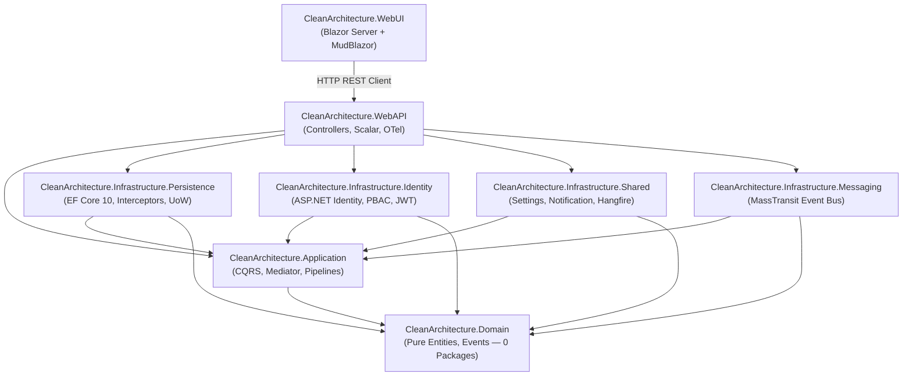
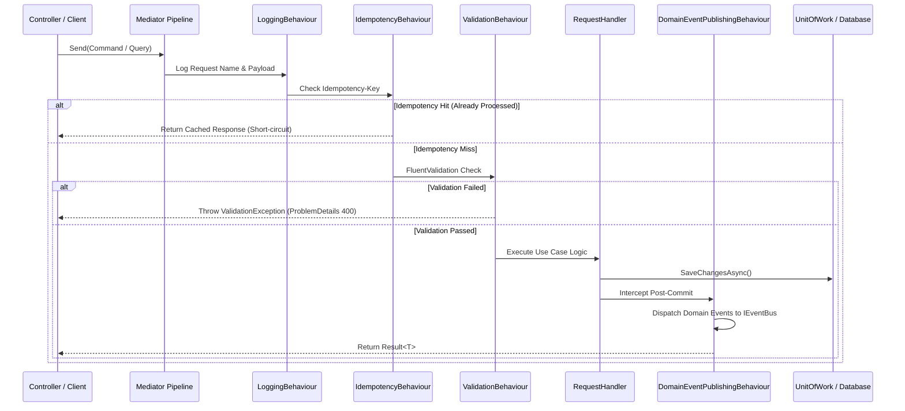

# 🏛️ Architecture & System Design Documentation

This document describes the technical architecture, design principles, layer dependency rules, design patterns, and data flow for the **Clean Architecture Template Solution (.NET 10)**.

---

## 📑 Table of Contents
1. [Architectural Principles](#1-architectural-principles)
2. [Solution Diagram & Dependency Rules](#2-solution-diagram--dependency-rules)
3. [Layer Breakdown & Responsibilities](#3-layer-breakdown--responsibilities)
   - [Core: Domain](#a-core--cleanarchitecturedomain)
   - [Core: Application](#b-core--cleanarchitectureapplication)
   - [Infrastructure: Persistence](#c-infrastructure--cleanarchitectureinfrastructurepersistence)
   - [Infrastructure: Identity & PBAC](#d-infrastructure--cleanarchitectureinfrastructureidentity)
   - [Infrastructure: Shared Services](#e-infrastructure--cleanarchitectureinfrastructureshared)
   - [Infrastructure: Messaging](#f-infrastructure--cleanarchitectureinfrastructuremessaging)
   - [Presentation: WebAPI](#g-presentation--cleanarchitecturewebapi)
   - [Presentation: WebUI (Blazor Server)](#h-presentation--cleanarchitecturewebui)
4. [Key Design Patterns & Cross-Cutting Concerns](#4-key-design-patterns--cross-cutting-concerns)
   - [CQRS & Mediator Pipeline Behaviours](#a-cqrs--mediator-pipeline-behaviours)
   - [Audit Trail & Mutation Diffing Interceptor](#b-audit-trail--mutation-diffing-interceptor)
   - [Permission-Based Access Control (PBAC) Engine](#c-permission-based-access-control-pbac-engine)
   - [Dynamic Runtime App Settings & Feature Flags](#d-dynamic-runtime-app-settings--feature-flags)
   - [Idempotency & Double-Submit Protection](#e-idempotency--double-submit-protection)
   - [In-App Notification Framework](#f-in-app-notification-framework)
5. [Database Strategy & Multi-DbContext Architecture](#5-database-strategy--multi-dbcontext-architecture)
6. [Observability & API Documentation](#6-observability--api-documentation)
7. [Testing Strategy](#7-testing-strategy)
8. [NuGet Template Distribution](#8-nuget-template-distribution)

---

## 1. Architectural Principles

This solution is designed following the tenets of **Clean Architecture (Onion / Hexagonal Architecture)**:

- **Framework Independence:** The business core does not depend on external frameworks, UI libraries, or database engines.
- **Dependency Rule:** Code dependencies only point inward (*Inward Dependency*). Inner layers know nothing about outer layers.
- **Domain-Driven Design (DDD) Lite:** Entities encapsulate enterprise business rules and emit *Domain Events*.
- **CQRS (Command Query Responsibility Segregation):** Strict separation between state mutation operations (*Commands*) and read-only queries (*Queries*).
- **Result Pattern:** Explicit business failure modeling without relying on expensive exception flows.

---

## 2. Solution Diagram & Dependency Rules

```text
                     ┌───────────────────────────────────────────────┐
                     │            CleanArchitecture.WebUI            │
                     │          (Blazor Server + MudBlazor)          │
                     └───────────────────────┬───────────────────────┘
                                             │ HTTP REST Client
                                             ▼
                     ┌───────────────────────────────────────────────┐
                     │            CleanArchitecture.WebAPI           │
                     │        (REST Controllers, Scalar, OTel)       │
                     └───┬───────────────┬───────────────┬───────┬───┘
                         │               │               │       │
                         ▼               ▼               ▼       ▼
    ┌────────────────────────┐ ┌───────────────────┐ ┌─────────┐ ┌───────────┐
    │ Persistence            │ │ Identity          │ │ Shared  │ │ Messaging │
    │ (EF Core 10, UoW)      │ │ (PBAC, JWT, Roles)│ │ (Tasks) │ │ (Events)  │
    └───────────┬────────────┘ └─────────┬─────────┘ └────┬────┘ └─────┬─────┘
                │                        │                │            │
                └────────────────────────┼────────────────┴────────────┘
                                         │ Implements Interfaces & Handlers
                                         ▼
                     ┌───────────────────────────────────────────────┐
                     │         CleanArchitecture.Application         │
                     │     (CQRS, Source-Gen Mediator, Pipelines)    │
                     └───────────────────────┬───────────────────────┘
                                             │ Depends Inward Only
                                             ▼
                     ┌───────────────────────────────────────────────┐
                     │            CleanArchitecture.Domain           │
                     │      (Pure Entities & Events — 0 Packages)    │
                     └───────────────────────────────────────────────┘
```

<details>
<summary><b>📊 Click to view Mermaid Interactive Diagram</b></summary>



</details>

---

## 3. Layer Breakdown & Responsibilities

### A. Core: [`CleanArchitecture.Domain`](../src/Core/CleanArchitecture.Domain)
The innermost layer with zero dependencies on third-party packages or other solution projects.
- **Entities:**
  - [`Product`](../src/Core/CleanArchitecture.Domain/Entities/Product.cs): Catalog business entity with status validation, pricing rules, and `ProductCreatedEvent` domain event.
  - [`AppSetting`](../src/Core/CleanArchitecture.Domain/Entities/AppSetting.cs): Dynamic runtime configuration and database-backed feature flags.
  - [`AuditLog`](../src/Core/CleanArchitecture.Domain/Entities/AuditLog.cs): Historical data modification records capturing before vs after values (JSON diff).
  - [`Notification`](../src/Core/CleanArchitecture.Domain/Entities/Notification.cs): In-app notification entity supporting user-targeted or system-wide broadcast alerts.
- **Common:**
  - [`BaseEntity`](../src/Core/CleanArchitecture.Domain/Common/BaseEntity.cs): Generic `Id` identifier and domain event staging collection.
  - [`BaseAuditableEntity`](../src/Core/CleanArchitecture.Domain/Common/BaseAuditableEntity.cs): Audit metadata fields (`CreatedAt`, `CreatedBy`, `LastModifiedAt`, `LastModifiedBy`).
  - [`ISoftDeletable`](../src/Core/CleanArchitecture.Domain/Common/ISoftDeletable.cs): Logical deletion contract (`IsDeleted`, `DeletedAt`).

### B. Core: [`CleanArchitecture.Application`](../src/Core/CleanArchitecture.Application)
Defines application use cases and orchestrates business execution flow.
- **CQRS Handlers:** Organized modularly under `Features/` (`AppSettings`, `AuditLogs`, `Notifications`, `Products`). Each feature contains dedicated `Commands/` and `Queries/`.
- **Pipeline Behaviours (Mediator):** Intercepts every request consistently (Logging, Validation, Idempotency, Event Dispatching).
- **Abstractions (Interfaces):**
  - [`IApplicationDbContext`](../src/Core/CleanArchitecture.Application/Common/Interfaces/IApplicationDbContext.cs) & [`IUnitOfWork`](../src/Core/CleanArchitecture.Application/Common/Interfaces/IUnitOfWork.cs): Transactional data access contracts.
  - [`IPermissionService`](../src/Core/CleanArchitecture.Application/Common/Interfaces/IPermissionService.cs): Granular permission evaluation contract.
  - [`INotificationService`](../src/Core/CleanArchitecture.Application/Common/Interfaces/INotificationService.cs): User alert delivery contract.
  - [`IAppSettingsService`](../src/Core/CleanArchitecture.Application/Common/Interfaces/IAppSettingsService.cs): Cached runtime configuration provider.
  - [`IEventBus`](../src/Core/CleanArchitecture.Application/Common/Interfaces/IEventBus.cs): Asynchronous messaging bus contract.

### C. Infrastructure: [`CleanArchitecture.Infrastructure.Persistence`](../src/Infrastructure/CleanArchitecture.Infrastructure.Persistence)
Entity Framework Core 10 data access implementation for SQL Server.
- [`ApplicationDbContext`](../src/Infrastructure/CleanArchitecture.Infrastructure.Persistence/ApplicationDbContext.cs): Configures `DbSet`, global query filters for `ISoftDeletable`, and fluent Entity Type Configurations.
- [`AuditableEntityInterceptor`](../src/Infrastructure/CleanArchitecture.Infrastructure.Persistence/Interceptors/AuditableEntityInterceptor.cs): EF Core SaveChanges interceptor that automatically populates audit metadata and captures in-depth JSON mutation diffs.
- [`UnitOfWork`](../src/Infrastructure/CleanArchitecture.Infrastructure.Persistence/UnitOfWork.cs) & [`Repository<T>`](../src/Infrastructure/CleanArchitecture.Infrastructure.Persistence/Repository.cs): Decouples EF Core DbContext from application use cases.

### D. Infrastructure: [`CleanArchitecture.Infrastructure.Identity`](../src/Infrastructure/CleanArchitecture.Infrastructure.Identity)
User identity management, JWT token services, and Permission-Based Access Control (PBAC).
- [`IdentityDbContext`](../src/Infrastructure/CleanArchitecture.Infrastructure.Identity/IdentityDbContext.cs): Isolated from the main application database for clean security boundary separation.
- [`TokenService`](../src/Infrastructure/CleanArchitecture.Infrastructure.Identity/Services/TokenService.cs): Handles secure JWT Access Token generation, permission claim enrichment, and Refresh Token rotation.
- **PBAC Engine:** [`PermissionPolicyProvider`](../src/Infrastructure/CleanArchitecture.Infrastructure.Identity/Security/PermissionPolicyProvider.cs), [`PermissionAuthorizationHandler`](../src/Infrastructure/CleanArchitecture.Infrastructure.Identity/Security/PermissionAuthorizationHandler.cs), and [`PermissionService`](../src/Infrastructure/CleanArchitecture.Infrastructure.Identity/Services/PermissionService.cs) with in-memory caching.

### E. Infrastructure: [`CleanArchitecture.Infrastructure.Shared`](../src/Infrastructure/CleanArchitecture.Infrastructure.Shared)
General infrastructure services and cross-cutting components:
- [`DbAppSettingsService`](../src/Infrastructure/CleanArchitecture.Infrastructure.Shared/Services/DbAppSettingsService.cs): Manages runtime configuration with graceful fallback to `IConfiguration`.
- [`NotificationService`](../src/Infrastructure/CleanArchitecture.Infrastructure.Shared/Services/NotificationService.cs): Persists and manages user notification read states.
- [`IdempotencyService`](../src/Infrastructure/CleanArchitecture.Infrastructure.Shared/Services/IdempotencyService.cs): Caches execution results to prevent duplicate transaction submissions.
- [`SmtpEmailService`](../src/Infrastructure/CleanArchitecture.Infrastructure.Shared/Services/SmtpEmailService.cs): Standard SMTP email delivery service.
- [`QueuedHostedService`](../src/Infrastructure/CleanArchitecture.Infrastructure.Shared/Services/QueuedHostedService.cs) & **Hangfire:** Handles persistent background tasks and scheduled recurring jobs.

### F. Infrastructure: [`CleanArchitecture.Infrastructure.Messaging`](../src/Infrastructure/CleanArchitecture.Infrastructure.Messaging)
Asynchronous message bus integration backed by **MassTransit**:
- Default transport: **InMemory** (zero setup required for local development and integration tests).
- Production transports switchable via `appsettings.json`: **RabbitMQ** or **ActiveMQ**.
- [`MassTransitEventBus`](../src/Infrastructure/CleanArchitecture.Infrastructure.Messaging/MassTransitEventBus.cs) implements `IEventBus`.
- Consumers (such as `ProductCreatedConsumer`) react to domain events asynchronously.

### G. Presentation: [`CleanArchitecture.WebAPI`](../src/Presentation/CleanArchitecture.WebAPI)
RESTful API gateway for external consumers and the Blazor WebUI:
- **Controllers:** `AuthController`, `ProductsController`, `UsersController`, `AuditLogsController`, `AppSettingsController`, `NotificationsController`, `JobsController`.
- **API Versioning:** Powered by `Asp.Versioning` (URL segments `/api/v1/...` and `X-Api-Version` headers).
- **Scalar UI Offline:** Modern interactive API documentation at `/scalar/v1`, bundled locally via `/js/scalar.min.js` (100% offline and air-gapped capable).
- **Observability:** Complete OpenTelemetry integration (Logs, Traces, Metrics) streaming to OTLP collectors and console.
- **Security & Resilience:** ASP.NET Core Rate Limiting (Fixed global & strict auth policies), Output Caching, and Global Exception Handling Middleware.

### H. Presentation: [`CleanArchitecture.WebUI`](../src/Presentation/CleanArchitecture.WebUI)
Interactive enterprise frontend built with **Blazor Server** (.NET 10) and **MudBlazor Material Design**:
- Executive Dashboard with real-time KPI metrics (`Home.razor`).
- Dynamic Role-Permission Matrix for PBAC administration (`Users.razor`).
- Interactive Audit Trail with side-by-side JSON diff viewer (`AuditLogs.razor`).
- Runtime App Settings & Feature Flags management panel (`AppSettings.razor`).
- Reactive Topbar Notification Panel with optimistic badge counts (`NotificationPanel.razor`).
- Spotlight Command Palette (`CommandPalette.razor` via `Ctrl + K` / `Cmd + K`).
- Reusable Shared Component Library (`PageHeader`, `EmptyState`, `ConfirmDeleteDialog`, `TableSkeleton`, `StatCard`).
- Secure client architecture: [`ApiAuthenticationStateProvider`](../src/Presentation/CleanArchitecture.WebUI/Services/ApiAuthenticationStateProvider.cs), [`TokenProvider`](../src/Presentation/CleanArchitecture.WebUI/Services/TokenProvider.cs), silent token refresh, and typed HTTP clients.

---

## 4. Key Design Patterns & Cross-Cutting Concerns

### A. CQRS & Mediator Pipeline Behaviours
Request execution follows a consistent, decoupled pipeline:


### B. Audit Trail & Mutation Diffing Interceptor
Every entity state modification in [`ApplicationDbContext`](../src/Infrastructure/CleanArchitecture.Infrastructure.Persistence/ApplicationDbContext.cs) is monitored by [`AuditableEntityInterceptor`](../src/Infrastructure/CleanArchitecture.Infrastructure.Persistence/Interceptors/AuditableEntityInterceptor.cs):
1. **Pre-Save Phase:** Automatically populates `CreatedAt`, `CreatedBy`, `LastModifiedAt`, and `LastModifiedBy` based on the active user context (`ICurrentUserService`).
2. **Mutation Auditing:** Extracts snapshots of before (`OldValues`) and after (`NewValues`) in JSON format, detects modified properties, and writes records into the `AuditLogs` table within the same database transaction.

### C. Permission-Based Access Control (PBAC) Engine
Rather than coupling authorization to hardcoded role strings (`[Authorize(Roles = "Admin")]`), the application uses granular permissions:
- Usage: `[HasPermission(Permissions.Products.Create)]`
- `PermissionPolicyProvider` detects permission policy prefixes and dynamically registers authorization policies.
- `PermissionAuthorizationHandler` evaluates whether the user's JWT contains the required permission claim or if the user's assigned role has the permission mapped.
- `PermissionService` caches role-permission mappings using `IMemoryCache` (15-minute TTL) with automatic cache invalidation upon updates.

### D. Dynamic Runtime App Settings & Feature Flags
- System settings are stored in the `AppSettings` database table.
- Settings can be modified at runtime via the WebUI without requiring application restarts or redeployments.
- [`DbAppSettingsService`](../src/Infrastructure/CleanArchitecture.Infrastructure.Shared/Services/DbAppSettingsService.cs) queries in-memory cache first, falling back to database entries and gracefully defaulting to `appsettings.json` file settings.

### E. Idempotency & Double-Submit Protection
For sensitive operations (e.g. checkout, create product, financial transaction):
- Clients send the HTTP header `Idempotency-Key: <unique-guid>`.
- [`IdempotencyBehaviour`](../src/Core/CleanArchitecture.Application/Common/Behaviours/IdempotencyBehaviour.cs) checks if the key is currently being processed (preventing race conditions) or has already completed.
- Completed responses are returned directly from cache without re-executing business logic.

### F. In-App Notification Framework
- Uses [`INotificationService`](../src/Core/CleanArchitecture.Application/Common/Interfaces/INotificationService.cs) to dispatch alerts.
- Supports targeted personal notifications (`TargetUserId`) and system-wide broadcast alerts (`TargetUserId == null`).
- Integrates with MassTransit consumers and background workers for asynchronous dispatch.

---

## 5. Database Strategy & Multi-DbContext Architecture

The solution cleanly decouples application domain data from security and background storage:

| DbContext | Default Physical Database | Responsibility & Entities |
|---|---|---|
| [`ApplicationDbContext`](../src/Infrastructure/CleanArchitecture.Infrastructure.Persistence/ApplicationDbContext.cs) | `CleanArchitectureDb` | Stores core business entities (`Products`, `AuditLogs`, `AppSettings`, `Notifications`). Maintained via Persistence layer EF Core migrations. |
| [`IdentityDbContext`](../src/Infrastructure/CleanArchitecture.Infrastructure.Identity/IdentityDbContext.cs) | `CleanArchitectureIdentityDb` | Stores ASP.NET Core Identity tables (`AspNetUsers`, `AspNetRoles`, `RoleClaims`, `RolePermissions`, `RefreshTokens`). Maintained via Identity layer migrations. |
| **Hangfire Storage** | `CleanArchitectureHangfireDb` | Stores scheduler states and persistent background jobs. Database tables are provisioned automatically at startup. |

> [!NOTE]
> Separating Identity and Application databases simplifies enterprise security compliance (e.g. isolating sensitive credential databases from transaction databases across physical servers).

---

## 6. Observability & API Documentation

- **Distributed Tracing & Metrics (OpenTelemetry):**
  Configured in `Program.cs` for both WebAPI and WebUI. Instruments ASP.NET Core, HttpClient, and SQL Client, streaming telemetry via gRPC OTLP to collectors such as Jaeger, Grafana Tempo, or Azure Application Insights.
- **Offline Scalar UI:**
  A modern OpenAPI documentation interface at `/scalar/v1`. The JavaScript bundle [`scalar.min.js`](../src/Presentation/CleanArchitecture.WebAPI/wwwroot/js/scalar.min.js) is served locally from WebAPI `wwwroot`, ensuring complete functionality in air-gapped or restricted intranet enterprise networks.

---

## 7. Testing Strategy

The solution includes a multi-layered testing pyramid utilizing **xUnit**, **FluentAssertions**, and **Moq**:

1. **Domain Unit Tests ([`CleanArchitecture.Domain.UnitTests`](../tests/CleanArchitecture.Domain.UnitTests)):** Tests domain entity invariants, business rules, and domain event dispatching.
2. **Application Unit Tests ([`CleanArchitecture.Application.UnitTests`](../tests/CleanArchitecture.Application.UnitTests)):** Tests FluentValidation rules, Mapster profiles, and CQRS handlers with mocked dependencies.
3. **Integration Tests ([`CleanArchitecture.Application.IntegrationTests`](../tests/CleanArchitecture.Application.IntegrationTests)):**
   - Utilizes `Microsoft.AspNetCore.Mvc.Testing.WebApplicationFactory`.
   - Uses **SQLite In-Memory** to replace SQL Server during automated test execution.
   - Tests end-to-end REST API request cycles (routing, validation, middleware, JWT authorization, and database persistence) with zero external database dependencies.

---

## 8. NuGet Template Distribution

This repository packages directly as a reusable `dotnet new` template:
- Configured in [`Minimdev.CleanArchitecture.Template.csproj`](../Minimdev.CleanArchitecture.Template.csproj) and [`.template.config/template.json`](../.template.config/template.json).
- Parameter replacement automatically renames all occurrences of `CleanArchitecture` with the chosen project name (`dotnet new cleanarch -n <ProjectName>`).
- Automated publishing script provided at [`publish.ps1`](../publish.ps1), with workflow instructions documented in [`docs/RELEASE_PROCESS.md`](RELEASE_PROCESS.md).
