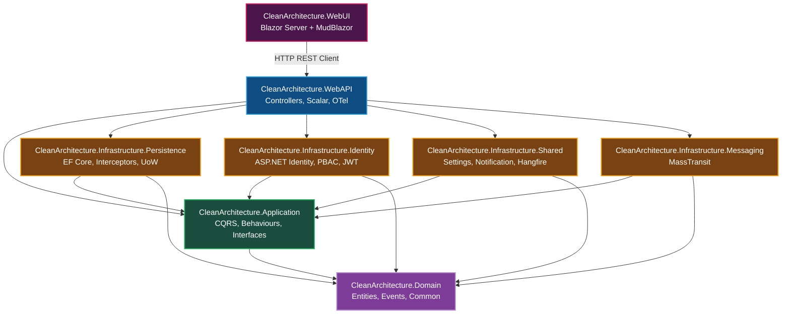
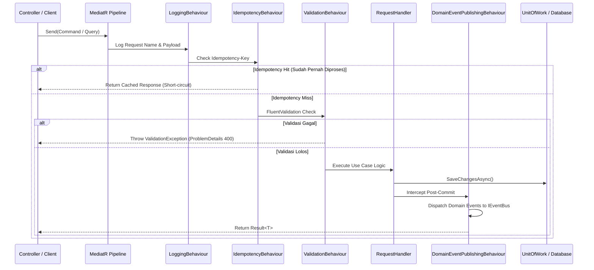

# 🏛️ Architecture & System Design Documentation

Dokumen ini memuat arsitektur teknis, prinsip desain, diagram ketergantungan layer, pola implementasi, serta alur data untuk **Clean Architecture Template Solution (.NET 10)**.

---

## 📑 Daftar Isi
1. [Prinsip Arsitektur](#1-prinsip-arsitektur)
2. [Diagram Solusi & Dependency Rules](#2-diagram-solusi--dependency-rules)
3. [Rincian Layer & Tanggung Jawab](#3-rincian-layer--tanggung-jawab)
   - [Core: Domain](#a-core--cleanarchitecturedomain)
   - [Core: Application](#b-core--cleanarchitectureapplication)
   - [Infrastructure: Persistence](#c-infrastructure--cleanarchitectureinfrastructurepersistence)
   - [Infrastructure: Identity & PBAC](#d-infrastructure--cleanarchitectureinfrastructureidentity)
   - [Infrastructure: Shared Services](#e-infrastructure--cleanarchitectureinfrastructureshared)
   - [Infrastructure: Messaging](#f-infrastructure--cleanarchitectureinfrastructuremessaging)
   - [Presentation: WebAPI](#g-presentation--cleanarchitecturewebapi)
   - [Presentation: WebUI (Blazor Server)](#h-presentation--cleanarchitecturewebui)
4. [Pola Desain Kunci & Cross-Cutting Concerns](#4-pola-desain-kunci--cross-cutting-concerns)
   - [CQRS & MediatR Pipeline Behaviours](#a-cqrs--mediatr-pipeline-behaviours)
   - [Audit Trail & Mutation Diffing Interceptor](#b-audit-trail--mutation-diffing-interceptor)
   - [Permission-Based Access Control (PBAC) Engine](#c-permission-based-access-control-pbac-engine)
   - [Dynamic Runtime App Settings & Feature Flags](#d-dynamic-runtime-app-settings--feature-flags)
   - [Idempotency & Double-Submit Protection](#e-idempotency--double-submit-protection)
   - [In-App Notification Framework](#f-in-app-notification-framework)
5. [Strategi Basis Data & Multi-DbContext](#5-strategi-basis-data--multi-dbcontext)
6. [Observability & Dokumentasi API](#6-observability--dokumentasi-api)
7. [Strategi Pengujian (Testing Strategy)](#7-strategi-pengujian-testing-strategy)
8. [Distribusi NuGet Template](#8-distribusi-nuget-template)

---

## 1. Prinsip Arsitektur

Solusi ini dirancang mengikuti panduan **Clean Architecture (Onion / Hexagonal Architecture)**:

- **Independensi Framework:** Core bisnis tidak terikat pada framework eksternal, UI, maupun database engine.
- **Dependency Rule:** Ketergantungan kode hanya boleh mengarah ke dalam (*Inward Dependency*). Lapisan dalam tidak mengetahui apapun tentang lapisan luar.
- **Domain-Driven Design (DDD) Lite:** Entitas mengisolasi aturan bisnis enterprise dan memancarkan *Domain Events*.
- **CQRS (Command Query Responsibility Segregation):** Pemisahan tegas antara operasi mutasi data (*Commands*) dan kueri pembacaan data (*Queries*).
- **Result Pattern:** Penanganan kegagalan bisnis secara eksplisit tanpa mengandalkan exception flow yang berat.

---

## 2. Diagram Solusi & Dependency Rules

---

## 3. Rincian Layer & Tanggung Jawab

### A. Core: [`CleanArchitecture.Domain`](../src/Core/CleanArchitecture.Domain)
Lapisan terdalam tanpa dependensi ke paket pihak ketiga atau proyek lain dalam solusi.
- **Entities:**
  - [`Product`](../src/Core/CleanArchitecture.Domain/Entities/Product.cs): Entitas bisnis katalog barang dengan validasi status, harga, dan domain event `ProductCreatedEvent`.
  - [`AppSetting`](../src/Core/CleanArchitecture.Domain/Entities/AppSetting.cs): Konfigurasi runtime dinamis dan feature flag berbasis database.
  - [`AuditLog`](../src/Core/CleanArchitecture.Domain/Entities/AuditLog.cs): Riwayat mutasi data yang mencakup old values vs new values (JSON diff).
  - [`Notification`](../src/Core/CleanArchitecture.Domain/Entities/Notification.cs): Entitas pesan in-app terarah maupun broadcast.
- **Common:**
  - [`BaseEntity`](../src/Core/CleanArchitecture.Domain/Common/BaseEntity.cs): Menyediakan identifier `Id` bertipe generic dan domain event staging list.
  - [`BaseAuditableEntity`](../src/Core/CleanArchitecture.Domain/Common/BaseAuditableEntity.cs): Field audit (`CreatedAt`, `CreatedBy`, `LastModifiedAt`, `LastModifiedBy`).
  - [`ISoftDeletable`](../src/Core/CleanArchitecture.Domain/Common/ISoftDeletable.cs): Interface penanda logical delete (`IsDeleted`, `DeletedAt`).

### B. Core: [`CleanArchitecture.Application`](../src/Core/CleanArchitecture.Application)
Mendefinisikan use cases aplikasi dan mengkoordinasikan eksekusi perintah bisnis.
- **CQRS Handlers:** Diatur modular di bawah folder `Features/` (`AppSettings`, `AuditLogs`, `Notifications`, `Products`). Setiap fitur memuat `Commands/` dan `Queries/`.
- **Pipeline Behaviours (MediatR):** Meng-intercept setiap request secara konsisten (Logging, Validasi, Idempotensi, Event Dispatch).
- **Abstraksi (Interfaces):**
  - [`IApplicationDbContext`](../src/Core/CleanArchitecture.Application/Common/Interfaces/IApplicationDbContext.cs) & [`IUnitOfWork`](../src/Core/CleanArchitecture.Application/Common/Interfaces/IUnitOfWork.cs): Kontrak akses data transactional.
  - [`IPermissionService`](../src/Core/CleanArchitecture.Application/Common/Interfaces/IPermissionService.cs): Abstraksi otorisasi hak akses granular.
  - [`INotificationService`](../src/Core/CleanArchitecture.Application/Common/Interfaces/INotificationService.cs): Pengiriman notifikasi pengguna.
  - [`IAppSettingsService`](../src/Core/CleanArchitecture.Application/Common/Interfaces/IAppSettingsService.cs): Pembacaan setting runtime ber-cache.
  - [`IEventBus`](../src/Core/CleanArchitecture.Application/Common/Interfaces/IEventBus.cs): Abstraksi asynchronous messaging bus.

### C. Infrastructure: [`CleanArchitecture.Infrastructure.Persistence`](../src/Infrastructure/CleanArchitecture.Infrastructure.Persistence)
Implementasi akses data Entity Framework Core 10 untuk SQL Server.
- [`ApplicationDbContext`](../src/Infrastructure/CleanArchitecture.Infrastructure.Persistence/ApplicationDbContext.cs): Mengonfigurasi `DbSet`, global query filters untuk `ISoftDeletable`, dan Entity Type Configurations.
- [`AuditableEntityInterceptor`](../src/Infrastructure/CleanArchitecture.Infrastructure.Persistence/Interceptors/AuditableEntityInterceptor.cs): Interceptor EF Core untuk pengisian audit fields otomatis dan perekaman mutasi audit logs mendalam.
- [`UnitOfWork`](../src/Infrastructure/CleanArchitecture.Infrastructure.Persistence/UnitOfWork.cs) & [`Repository<T>`](../src/Infrastructure/CleanArchitecture.Infrastructure.Persistence/Repository.cs): Mengabstraksi EF Core DbContext dari logic aplikasi.

### D. Infrastructure: [`CleanArchitecture.Infrastructure.Identity`](../src/Infrastructure/CleanArchitecture.Infrastructure.Identity)
Layanan identitas pengguna, autentikasi berbasis token JWT, dan otorisasi PBAC.
- [`IdentityDbContext`](../src/Infrastructure/CleanArchitecture.Infrastructure.Identity/IdentityDbContext.cs): Terpisah dari basis data aplikasi utama untuk pemisahan data keamanan yang bersih.
- [`TokenService`](../src/Infrastructure/CleanArchitecture.Infrastructure.Identity/Services/TokenService.cs): Menangani pembuatan JWT Access Token dan rotasi aman Refresh Token.
- **Mesin Otorisasi PBAC:** [`PermissionPolicyProvider`](../src/Infrastructure/CleanArchitecture.Infrastructure.Identity/Security/PermissionPolicyProvider.cs), [`PermissionAuthorizationHandler`](../src/Infrastructure/CleanArchitecture.Infrastructure.Identity/Security/PermissionAuthorizationHandler.cs), dan [`PermissionService`](../src/Infrastructure/CleanArchitecture.Infrastructure.Identity/Services/PermissionService.cs) dengan caching memory.

### E. Infrastructure: [`CleanArchitecture.Infrastructure.Shared`](../src/Infrastructure/CleanArchitecture.Infrastructure.Shared)
Layanan pendukung dan infrastruktur umum:
- [`DbAppSettingsService`](../src/Infrastructure/CleanArchitecture.Infrastructure.Shared/Services/DbAppSettingsService.cs): Mengelola pengaturan runtime dengan fallback otomatis ke `IConfiguration`.
- [`NotificationService`](../src/Infrastructure/CleanArchitecture.Infrastructure.Shared/Services/NotificationService.cs): Menyimpan dan mengelola status keterbacaan notifikasi.
- [`IdempotencyService`](../src/Infrastructure/CleanArchitecture.Infrastructure.Shared/Services/IdempotencyService.cs): Caching respons untuk pencegahan transaksi ganda.
- [`SmtpEmailService`](../src/Infrastructure/CleanArchitecture.Infrastructure.Shared/Services/SmtpEmailService.cs): Implementasi pengiriman email SMTP.
- [`QueuedHostedService`](../src/Infrastructure/CleanArchitecture.Infrastructure.Shared/Services/QueuedHostedService.cs) & **Hangfire:** Penanganan tugas latar belakang dan recurring background jobs.

### F. Infrastructure: [`CleanArchitecture.Infrastructure.Messaging`](../src/Infrastructure/CleanArchitecture.Infrastructure.Messaging)
Integrasi asynchronous message bus berbasis **MassTransit**:
- Default transport: **InMemory** (bebas instalasi external broker untuk development dan testing).
- Switchable production transport via konfigurasi `appsettings.json`: **RabbitMQ** atau **ActiveMQ**.
- [`MassTransitEventBus`](../src/Infrastructure/CleanArchitecture.Infrastructure.Messaging/MassTransitEventBus.cs) mengimplementasikan `IEventBus`.
- Consumers (seperti `ProductCreatedConsumer`) merespons domain event secara asinkron.

### G. Presentation: [`CleanArchitecture.WebAPI`](../src/Presentation/CleanArchitecture.WebAPI)
Gateway RESTful API untuk klien eksternal dan WebUI:
- **Controllers:** `AuthController`, `ProductsController`, `UsersController`, `AuditLogsController`, `AppSettingsController`, `NotificationsController`, `JobsController`.
- **API Versioning:** Menggunakan `Asp.Versioning` (URL segment `/api/v1/...` dan header `X-Api-Version`).
- **Dokumentasi Scalar UI:** Dokumentasi modern di route `/scalar/v1`, berjalan 100% offline via static bundle lokal `/js/scalar.min.js`.
- **Observability:** Integrasi OpenTelemetry lengkap (Logs, Traces, Metrics) ke OTLP exporter dan console.
- **Keamanan & Ketahanan:** ASP.NET Core Rate Limiting (Fixed global & strict auth policy), Output Caching, dan Global Exception Handling Middleware.

### H. Presentation: [`CleanArchitecture.WebUI`](../src/Presentation/CleanArchitecture.WebUI)
Frontend interaktif enterprise berbasis **Blazor Server** (.NET 10) dengan komponen **MudBlazor Material Design**:
- Desain *Executive Dashboard* dengan metrik interaktif (`Home.razor`).
- Matrix Role-Permission dinamis untuk administrasi PBAC (`Users.razor`).
- Timeline Audit Log dengan visual diff viewer (`AuditLogs.razor`).
- Runtime App Settings panel (`AppSettings.razor`).
- Glassmorphism topbar bell popover notification panel (`NotificationPanel.razor`).
- Arsitektur client-side aman: [`ApiAuthenticationStateProvider`](../src/Presentation/CleanArchitecture.WebUI/Services/ApiAuthenticationStateProvider.cs), [`TokenProvider`](../src/Presentation/CleanArchitecture.WebUI/Services/TokenProvider.cs), dan typed API clients.

---

## 4. Pola Desain Kunci & Cross-Cutting Concerns

### A. CQRS & MediatR Pipeline Behaviours
Alur pemrosesan request diatur oleh pipeline konsisten:

### B. Audit Trail & Mutation Diffing Interceptor
Setiap perubahan state pada entitas di [`ApplicationDbContext`](../src/Infrastructure/CleanArchitecture.Infrastructure.Persistence/ApplicationDbContext.cs) dipantau oleh [`AuditableEntityInterceptor`](../src/Infrastructure/CleanArchitecture.Infrastructure.Persistence/Interceptors/AuditableEntityInterceptor.cs):
1. **Fase Pre-Save:** Mengisi otomatis `CreatedAt`, `CreatedBy`, `LastModifiedAt`, dan `LastModifiedBy` berdasarkan konteks user aktif (`ICurrentUserService`).
2. **Pencatatan Mutasi:** Mengekstrak snapshot nilai sebelum (`OldValues`) dan sesudah (`NewValues`) ke dalam format JSON, mendeteksi daftar kolom yang dimodifikasi, lalu mencatatnya ke tabel `AuditLogs` dalam transaksi database yang sama.

### C. Permission-Based Access Control (PBAC) Engine
Daripada mengunci controller menggunakan string role kaku (`[Authorize(Roles = "Admin")]`), sistem menggunakan permission terperinci:
- Penggunaan: `[HasPermission(Permissions.Products.Create)]`
- `PermissionPolicyProvider` mendeteksi prefix kebijakan dan mendaftarkan policy secara dinamis.
- `PermissionAuthorizationHandler` memeriksa apakah token user memuat claim permission yang dibutuhkan atau apakah role user memiliki izin tersebut.
- `PermissionService` menggunakan `IMemoryCache` (TTL 15 menit) sehingga evaluasi permission tidak membebani database pada setiap request.

### D. Dynamic Runtime App Settings & Feature Flags
- Pengaturan aplikasi disimpan pada tabel `AppSettings`.
- Dapat diubah secara runtime melalui WebUI tanpa perlu merestart aplikasi atau redeploy.
- [`DbAppSettingsService`](../src/Infrastructure/CleanArchitecture.Infrastructure.Shared/Services/DbAppSettingsService.cs) memeriksa nilai di in-memory cache terlebih dahulu. Jika tidak ditemukan di database, sistem fallback secara graceful ke konfigurasi file `appsettings.json`.

### E. Idempotency & Double-Submit Protection
Untuk operasi finansial atau transaksi penting (misalnya checkout, submit form, payment):
- Client mengirimkan header HTTP `Idempotency-Key: <unique-guid>`.
- [`IdempotencyBehaviour`](../src/Core/CleanArchitecture.Application/Common/Behaviours/IdempotencyBehaviour.cs) memeriksa apakah key tersebut sedang diproses (mencegah *race-condition*) atau sudah pernah selesai diproses.
- Jika sudah selesai, hasil eksekusi sebelumnya langsung dikembalikan dari cache tanpa mengeksekusi ulang database logic.

### F. In-App Notification Framework
- Menggunakan [`INotificationService`](../src/Core/CleanArchitecture.Application/Common/Interfaces/INotificationService.cs) untuk membuat notifikasi.
- Mendukung pesan personal ke user tertentu (`TargetUserId`) atau broadcast ke seluruh sistem (`TargetUserId == null`).
- Terintegrasi dengan MassTransit consumer dan background task untuk pengiriman asinkron.

---

## 5. Strategi Basis Data & Multi-DbContext

Solusi ini memisahkan konteks data aplikasi dan konteks keamanan secara tegas:

| DbContext | Database Fisik Default | Tujuan & Entitas |
|---|---|---|
| [`ApplicationDbContext`](../src/Infrastructure/CleanArchitecture.Infrastructure.Persistence/ApplicationDbContext.cs) | `CleanArchitectureDb` | Menyimpan entitas bisnis (`Products`, `AuditLogs`, `AppSettings`, `Notifications`). Menggunakan EF Core Migration terpisah di layer Persistence. |
| [`IdentityDbContext`](../src/Infrastructure/CleanArchitecture.Infrastructure.Identity/IdentityDbContext.cs) | `CleanArchitectureIdentityDb` | Menyimpan data otentikasi ASP.NET Core Identity (`AspNetUsers`, `AspNetRoles`, `RoleClaims`, `RefreshTokens`). Menggunakan EF Core Migration terpisah di layer Identity. |
| **Hangfire Storage** | `CleanArchitectureHangfireDb` | Menyimpan state scheduler dan persistent background jobs Hangfire. Database dibuat secara otomatis saat startup. |

> [!NOTE]
> Pemisahan ini mempermudah kepatuhan keamanan enterprise (misalnya jika database kredensial dan user harus diisolasi di server yang berbeda dari data transaksi bisnis).

---

## 6. Observability & Dokumentasi API

- **Distributed Tracing & Metrics (OpenTelemetry):**
  Dikonfigurasi di `Program.cs` baik pada WebAPI maupun WebUI. Mendukung instrumentasi ASP.NET Core, HttpClient, SQL Client, dan pengiriman telemetri via protokol gRPC OTLP ke endpoint OTel Collector (seperti Jaeger, Grafana Tempo, atau Azure App Insights).
- **Scalar UI Offline:**
  Pengganti antarmuka Swagger konvensional dengan tampilan modern. File JavaScript [`scalar.min.js`](../src/Presentation/CleanArchitecture.WebAPI/wwwroot/js/scalar.min.js) di-bundle secara lokal di folder `wwwroot` WebAPI, sehingga dokumentasi tetap dapat diakses di lingkungan server tanpa akses internet (intranet/air-gapped environment).

---

## 7. Strategi Pengujian (Testing Strategy)

Proyek dilengkapi dengan 3 lapisan suite pengujian menggunakan **xUnit**, **FluentAssertions**, dan **Moq**:

1. **Domain Unit Tests ([`CleanArchitecture.Domain.UnitTests`](../tests/CleanArchitecture.Domain.UnitTests)):** Menguji validitas entitas, status invariants, dan pemancaran domain events.
2. **Application Unit Tests ([`CleanArchitecture.Application.UnitTests`](../tests/CleanArchitecture.Application.UnitTests)):** Menguji validator FluentValidation, Mapster profile, dan CQRS Handlers dengan mock dependencies.
3. **Integration Tests ([`CleanArchitecture.Application.IntegrationTests`](../tests/CleanArchitecture.Application.IntegrationTests)):**
   - Menggunakan `Microsoft.AspNetCore.Mvc.Testing.WebApplicationFactory`.
   - Menggunakan **SQLite In-Memory** untuk menggantikan SQL Server saat testing dijalankan.
   - Menguji seluruh flow REST API dari controller, middleware, otentikasi JWT, hingga pembacaan database tanpa ketergantungan server SQL eksternal.

---

## 8. Distribusi NuGet Template

Solusi ini dirancang sebagai starter template resmi:
- Didefinisikan di [`Minimdev.CleanArchitecture.Template.csproj`](../Minimdev.CleanArchitecture.Template.csproj) dan [`.template.config/template.json`](../.template.config/template.json).
- Parameter variabel otomatis mengganti seluruh kata `CleanArchitecture` dengan nama project pengguna (`dotnet new cleanarch -n <ProjectName>`).
- Script rilis otomatis disediakan di [`publish.ps1`](../publish.ps1) dan panduan rilis lengkap tersedia di [`docs/RELEASE_PROCESS.md`](RELEASE_PROCESS.md).
